# Distributed Circuit Breaker for PHP & Laravel

[](https://github.com/ahmed-nour-dev/circuit-breaker/actions/workflows/tests.yml)
[](https://packagist.org/packages/ahmednour/circuit-breaker)
[](LICENSE)

A distributed Circuit Breaker package for PHP 8.2+ and Laravel. Built with clean architecture principles to protect your applications from cascading failures when third-party APIs (SMS gateways, payment processors, CRMs, email providers, etc.) become degraded or unavailable.

---

## Key Features

- **Distributed State Management**: Shared Redis circuit state across multiple app instances and background workers.
- **Distributed Probe Locking**: A Redis lock lets a single worker at a time probe the external service in `HALF_OPEN` state, limiting retry stampedes. The lock has a TTL (`half_open_lock_timeout`); a probe that outlives it can overlap with another worker's probe, so set it above your slowest call.
- **Intelligent HTTP Failure Classification**: Differentiates client errors (`4xx` validation/bad requests) from infrastructure/server outages (`5xx`, Guzzle/Laravel connection exceptions). Matching on exception-message text such as `timeout` is opt-in: `new HttpFailureClassifier(matchMessagePatterns: true)`.
- **Self-Infrastructure Failure Resilience**: Storage-agnostic handling for its own infrastructure failures (e.g. Redis outages) supporting **Fail-Open**, **Fail-Closed**, and **Fallback** strategies.
- **Octane & Horizon Ready**: Seamless connection lifecycle management to prevent stale Redis connections across long-running workers.
- **Strict Separation of Concerns**: Pure domain logic decoupled from Laravel, Redis, and Guzzle.
- **Tested**: Unit, integration, and Redis infrastructure tests run in CI against PHP 8.2–8.4 and Laravel 10–13, with raw `\Redis` and Laravel's phpredis and predis connections.
- **Low overhead**: A successful call on a healthy closed circuit costs one Redis command (a `GET`) when using Laravel's Redis manager.

---

## Architecture & State Machine

```mermaid
stateDiagram-v2
    [*] --> Closed
    
    Closed --> Open: Failure threshold reached\n(e.g., 5 consecutive 5xx/timeouts;\nany success or 4xx resets the count)
    Closed --> Closed: Successful call / 4xx error (resets failure count)
    
    Open --> Open: Calls fail fast with CircuitOpenException\n(No external HTTP requests made)
    Open --> HalfOpen: Recovery timeout elapsed\n(e.g., 60s passed)
    
    HalfOpen --> Closed: Probe succeeds or fails with a 4xx (provider reachable; acquires lock, recovers circuit)
    HalfOpen --> Open: Probe fails (trips back to Open)
    HalfOpen --> HalfOpen: Another worker holds probe lock\n(throws CircuitBusyException)
```



---

## The Four Distinct Failure Types

A resilient circuit breaker must distinguish between four completely different failure scenarios:

| Failure Type | Example | Behavior |
| :--- | :--- | :--- |
| **1. Provider Failure** | Twilio returns `503 Service Unavailable` or cURL timeout | Increment failure count; trip to `OPEN` if threshold is reached. Re-throws provider exception. |
| **2. Circuit Open** | Provider is down and recovery timeout has not passed | Fails fast immediately by throwing `CircuitOpenException` without touching the provider. |
| **3. Circuit Busy** | Another worker is currently executing a probe in `HALF_OPEN` | Throws `CircuitBusyException` to avoid concurrent probes against an unhealthy dependency. |
| **4. Infrastructure Failure** | Redis server down, connection timeout, network partition | Caught by `CircuitBreaker` and delegated to the configured policy (`fail_open`, `fail_closed`, or `fallback`). |

---

## Installation

```bash
composer require ahmednour/circuit-breaker
```

### Laravel Service Provider

If package auto-discovery is enabled, `CircuitBreakerServiceProvider` is loaded automatically. Otherwise, add it to your `config/app.php` providers array:

```php
'providers' => [
    // ...
    AhmedNour\CircuitBreaker\Providers\CircuitBreakerServiceProvider::class,
],
```

Publish the configuration file:

```bash
php artisan vendor:publish --tag=circuit-breaker-config
```

---

## Probe lock TTL

`half_open_lock_timeout` (default **60 s**) is the TTL of the half-open probe lock. It is not extended while the probe runs, so it **must be greater than the timeout of the protected call** (e.g. your HTTP client timeout). If the lock expires mid-probe, another worker can start a second probe. Set the optional `call_timeout` on a policy to have the package reject a policy whose lock TTL is not greater than it. As a safeguard, a probe that finishes after its lock expired does not write its result to the circuit state.

The published config file is located at `config/circuit-breaker.php`:

```php
return [

    /*
    |--------------------------------------------------------------------------
    | Default Circuit Breaker Policy
    |--------------------------------------------------------------------------
    | Default policy applied when a provider does not specify custom rules.
    */
    'default' => [
        'failure_threshold'      => (int) env('CIRCUIT_BREAKER_DEFAULT_THRESHOLD', 5),
        'recovery_timeout'       => (int) env('CIRCUIT_BREAKER_DEFAULT_RECOVERY_TIMEOUT', 60),
        'half_open_lock_timeout' => (int) env('CIRCUIT_BREAKER_DEFAULT_LOCK_TIMEOUT', 60),
        // Optional: timeout of the protected call. When set, half_open_lock_timeout must exceed it.
        // 'call_timeout' => 30,
    ],

    /*
    |--------------------------------------------------------------------------
    | Provider-Specific Policies
    |--------------------------------------------------------------------------
    | Define custom thresholds, recovery timeouts, and probe lock TTLs per service.
    */
    'providers' => [
        // Shipped empty. Example:
        // 'payment-gateway' => [
        //     'failure_threshold'      => 3,
        //     'recovery_timeout'       => 60,
        //     'half_open_lock_timeout' => 60,
        // ],
    ],

    /*
    |--------------------------------------------------------------------------
    | Redis Connection & Key Prefixes
    |--------------------------------------------------------------------------
    */
    'redis' => [
        'connection'  => env('CIRCUIT_BREAKER_REDIS_CONNECTION', 'default'),
        'prefix'      => 'circuit:',
        'lock_suffix' => ':probe-lock',
    ],

    /*
    |--------------------------------------------------------------------------
    | Infrastructure Failure Handling
    |--------------------------------------------------------------------------
    | Strategy when Circuit Breaker storage (e.g. Redis) is unavailable:
    | - 'fail_open'   : Allow the operation to execute (default).
    | - 'fail_closed' : Reject the operation with CircuitInfrastructureException.
    | - 'fallback'    : Delegate to a configured InfrastructureFallback implementation.
    */
    'infrastructure_failure' => [
        'strategy' => env('CIRCUIT_BREAKER_INFRASTRUCTURE_FAILURE_STRATEGY', 'fail_open'),
        'fallback' => null, // e.g., App\Services\CircuitBreaker\DatabaseFallback::class
    ],

];
```

---

## Usage Examples

### 1. Basic Execution (Controllers / Services)

Wrap any external service call in the `execute` method:

```php
namespace App\Services;

use AhmedNour\CircuitBreaker\Application\CircuitBreaker;
use AhmedNour\CircuitBreaker\Domain\Exceptions\CircuitOpenException;
use AhmedNour\CircuitBreaker\Domain\Exceptions\CircuitBusyException;

class SmsService
{
    public function __construct(
        private readonly CircuitBreaker $circuitBreaker,
        private readonly TwilioClient $twilio,
    ) {}

    public function sendSms(string $to, string $message): string
    {
        try {
            return $this->circuitBreaker->execute('twilio-sms', function () use ($to, $message) {
                return $this->twilio->messages->create($to, [
                    'body' => $message,
                ]);
            });
        } catch (CircuitOpenException $e) {
            // Service is known to be down — fallback or notify user
            logger()->warning("Twilio circuit is OPEN. Failing fast.");
            throw new ServiceUnavailableException("SMS gateway is temporarily unavailable.");
        } catch (CircuitBusyException $e) {
            // Another worker is currently testing the connection
            logger()->info("Twilio circuit is HALF-OPEN probe busy.");
            throw new ServiceBusyException("SMS gateway is recovering, please retry shortly.");
        }
    }
}
```

---

### 2. Laravel Queues & Horizon Integration

Handle circuit open or busy states cleanly in queue jobs with automatic delay releases:

```php
namespace App\Jobs;

use AhmedNour\CircuitBreaker\Application\CircuitBreaker;
use AhmedNour\CircuitBreaker\Domain\Exceptions\CircuitBusyException;
use AhmedNour\CircuitBreaker\Domain\Exceptions\CircuitOpenException;
use Illuminate\Bus\Queueable;
use Illuminate\Contracts\Queue\ShouldQueue;
use Illuminate\Foundation\Bus\Dispatchable;
use Illuminate\Queue\InteractsWithQueue;
use Illuminate\Queue\SerializesModels;

class SendSmsNotificationJob implements ShouldQueue
{
    use Dispatchable, InteractsWithQueue, Queueable, SerializesModels;

    public int $tries = 5;

    public function __construct(
        public readonly string $phone,
        public readonly string $message,
    ) {}

    public function handle(CircuitBreaker $circuitBreaker, TwilioClient $twilio): void
    {
        try {
            $circuitBreaker->execute('twilio-sms', function () use ($twilio) {
                $twilio->send($this->phone, $this->message);
            });
        } catch (CircuitOpenException) {
            // Circuit is OPEN: Delay release by recovery window (e.g., 300s)
            $this->release(300);
        } catch (CircuitBusyException) {
            // Circuit is HALF_OPEN and another worker is probing: retry in 10s
            $this->release(10);
        }
    }
}
```

---

## Infrastructure Failure Strategies

If the Circuit Breaker's own storage (e.g. Redis) is down, the package uses the configured `infrastructure_failure.strategy`:

> **At-most-once guarantee:** the protected callback runs at most once per `execute()` call under every strategy. The strategy only applies when the breaker's storage fails *before* the callback runs (reading state, acquiring the half-open lock, moving open → half-open). If storage fails *after* the callback ran, recording the outcome is best-effort: a successful result is still returned, and a provider exception is rethrown unchanged. The callback is never re-invoked.

### 1. Fail Open (`fail_open` — Default)
Executes the protected callback anyway. Ideal when service availability is prioritized over protection to prevent a Redis outage from taking down your entire application.

```
Redis DOWN ──► FailOpenHandler ──► Execute Protected Operation
```

### 2. Fail Closed (`fail_closed`)
Rejects the operation and throws `CircuitInfrastructureException`. Ideal for high-risk operations (e.g. payments, money transfers, hard rate-limited APIs) where executing without safety guarantees is dangerous.

```
Redis DOWN ──► FailClosedHandler ──► Throws CircuitInfrastructureException
```

### 3. Fallback (`fallback`)
Delegates to an implementation of `InfrastructureFallback` (e.g. database-backed store or in-memory fallback).

```php
use AhmedNour\CircuitBreaker\Domain\CircuitExecution;
use AhmedNour\CircuitBreaker\Domain\Contracts\InfrastructureFallback;
use Throwable;

class DatabaseCircuitFallback implements InfrastructureFallback
{
    public function execute(CircuitExecution $execution, Throwable $exception): mixed
    {
        // Custom recovery logic, logging, or fallback execution
        return ($execution->callback)();
    }
}
```

Configure in `config/circuit-breaker.php`:
```php
'infrastructure_failure' => [
    'strategy' => 'fallback',
    'fallback' => App\Services\DatabaseCircuitFallback::class,
],
```

---

## HTTP Failure Classification

The default `HttpFailureClassifier` intelligently distinguishes real provider outages from normal client errors:

- **Does NOT Trip (Client Errors)**:
  - `400 Bad Request`, `401 Unauthorized`, `403 Forbidden`, `404 Not Found`, `422 Unprocessable Entity`
  - Application bugs and invalid user inputs do not count toward circuit trips.
- **Trips Circuit (Server & Network Errors)**:
  - `500 Internal Server Error`, `502 Bad Gateway`, `503 Service Unavailable`, `504 Gateway Timeout`
  - Guzzle `ConnectException` and `ServerException`
  - Laravel HTTP Client `ConnectionException`
  - Network error messages: `connection timed out`, `cURL error 28`, `connection refused`, `DNS resolution failed`, `reset by peer`

---

## Testing

Run the test suite using PHPUnit:

```bash
php vendor/bin/phpunit
```

To run with sail or Docker:
```bash
./vendor/bin/sail bin phpunit
```

### Standalone In-Memory Testing

Domain logic and state machines are fully decoupled and can be tested without Redis using the provided test doubles in `Tests\Support`:
- `InMemoryCircuitStore`
- `FakeLock`
- `FakeClock`
- `AlwaysTripFailureClassifier` / `NeverTripFailureClassifier`

---

## License

This package is open-sourced software licensed under the [MIT license](LICENSE).
